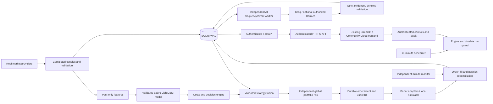

# Architecture

## Execution authority

This application supports paper execution only. `Settings.mode` accepts the literal `paper`; broker URLs are constants pointing to Alpaca Paper and OANDA Practice. There is no live adapter, withdrawal interface or configuration toggle that enables real-money trading. The local simulator is a separate execution mode, never an automatic substitute for a failed remote order.

## Modules and data flow

The broker interface covers account state, positions, open orders, market data/quotes, submit, cancel, reduce/close, order lookup and fills. Alpaca, OANDA and the local simulator implement the same contract. Broker responses are normalized without treating acceptance as a fill. Transport exceptions expose safe errors; credentials and raw authorization headers never belong in records.

## Market policy

| Instruments | Data/session | Remote execution | Protection and correlation |
| --- | --- | --- | --- |
| BTC/USD, ETH/USD | Real crypto candles/quotes; 24/7 | Alpaca Paper where account/pair eligible | Same crypto exposure group; hosted bracket unsupported, new remote entries disabled by default |
| SPY, QQQ | Alpaca free IEX bars/quotes where entitled; US exchange calendar including holidays/early closes | Alpaca Paper, whole-share long entries | Broker bracket stop/target; US index exposure group |
| EUR/USD, GBP/USD | OANDA completed M15 midpoint candles and tradable bid/ask; FX weekly session | USD OANDA Practice, non-MT4 API account | Attached stop/target, reduce-only exits; USD FX exposure group |

Every instrument has fee/slippage/spread assumptions, quantity precision, exposure cap and volatility parameters in the instrument registry. These are conservative configurable research assumptions, not a claim to know every broker account's actual fees. OANDA candle volume is tick activity rather than centralized trade volume. Alpaca IEX is a venue subset, not the full consolidated US tape. Crypto provider basis can differ from the execution venue; the live bid/ask and net-edge check remain mandatory. Unsupported providers/accounts/instruments record a disabled reason.

## Time and data integrity

All market timestamps are aware UTC. Candle timestamps represent opening time. A row is usable only when its opening time plus fifteen minutes is no later than the analysis clock. Validation checks ordering, duplicates, finite positive prices, consistent OHLC range, nonnegative volume, timestamp alignment and freshness; session-aware checks distinguish market closure from stale open-market data. Missing required history, malformed responses, gaps that invalidate a feature window and stale quotes block entry rather than interpolate an imaginary execution price.

The timer fires twenty seconds after the quarter-hour to allow publication. Restart catch-up evaluates the latest completed candle once, never replays old candles into current orders. Persistent run identifiers and a file lock prevent overlapping execution. Symbol/candle uniqueness and deterministic client order IDs protect retries and duplicate scheduler delivery.

## Research and activation

Features use historical returns, moving averages, RSI, MACD, ATR, realized volatility, momentum, volume/range/trend measures and clock/regime features. Labels describe future execution-aligned returns and are absent on unlabeled tail rows. Training, calibration, validation and test partitions are chronological, with a purge between them so label horizons cannot straddle partitions. Walk-forward evaluation fits only prior history. Seeds and training parameters are persisted with versioned artifacts and input provenance.

Probability calibration uses a past holdout, never the test period. The model predicts directional probability and an expected-return estimate. A separate rule baseline and buy-and-hold comparison are reported. A high probability alone cannot authorize an entry: expected return must exceed round-trip costs and the configured minimum edge, regime/liquidity/spread/session filters must pass, and global risk must approve.

Training saves a **candidate**. Explicit promotion checks validation criteria and artifact integrity before setting the active version. Missing, corrupt, wrong-symbol, unvalidated or old artifacts block trading. Expiry is based on the artifact's training time, not the last load. No profitability claim is made for a candidate that failed. Test reports distinguish the simulated assumptions from broker-confirmed fills.

## Cloud reasoning and fusion

Cloud reasoning is an independent interpretation module. Groq and optional authorized Nous Hermes adapters use documented HTTPS endpoints, explicit account-visible model selection, bounded request timeouts/retries, structured output and metered attempts. There is no fallback provider. No cloud AI calls occur until AI is enabled, credentials/model are configured and the account plan is explicitly declared. Hermes requires explicit paid-access authorization. Billing-plan declarations and local budgets do not certify a provider's free allowance.

The context is a bounded object of completed candles, causal trend/momentum/volatility/volume features, support/resistance estimates, the actual quant prediction and open positions. Verified news and macro context are explicitly absent when no real source is integrated. There is no arbitrary external-news prompt. The LLM receives neither secrets nor broker/control/code tools. Output requires an exact symbol/evidence timestamp and action/bias/regime consistency; unsupported actions, malformed or duplicate-key JSON, stale/future output, missing fields and invented numerical narrative claims are rejected. Confidence remains an uncalibrated opinion rather than a statistical probability.

The four strategy modes preserve quant authority. `quant_only` requires a validated active quant model and explicit execution enablement. `ai_filtered_quant` additionally permits a quant BUY only when timely validated AI agrees with BUY/long. `hybrid` adds conservative low-risk/bullish evidence gates rather than a weighted-confidence formula. AI HOLD/NO TRADE, disagreement, stale/invalid output, provider outage or missing approved certificate vetoes new AI-dependent entries. `ai_only_research` records recommendations and never executes. Existing validated quant/independent protective exits are not held hostage to the LLM.

AI-assisted strategies need a passing comparison and explicit stored-certificate approval, pinned to symbol, quant/AI model, provider, source policy and expiry. Evaluation replays genuine timestamped forward observations with chronological validation/test partitions, actual availability times and conservative estimated execution/costs. It never calls today's LLM to fabricate historical opinions. Reports separate quant-only, AI-filtered, hybrid and benchmarks; AI variants must improve validation/test results over quant-only as well as meet minimum observations/trades, positive after-cost return, Sharpe/profit-factor, drawdown and block-bootstrap gates. A replay is labeled `forward_replay`, not broker-confirmed P/L. AI-only has no executable expected-return calibration and cannot pass execution approval.

The analysis cycle remains every fifteen minutes. A separate worker checks AI gates at second 40 after each quarter-hour; the normal provider-analysis interval is sixty minutes, with a minimum fifteen-minute interval for material probability/price/regime/position changes. Valid same-state responses are cached only within their evidence freshness window. Each actual HTTP attempt reserves request/token budget in SQLite before sending; retries and model-discovery requests count. Unknown usage after timeouts/crashes retains a conservative reservation. Limits are shared across processes/providers and reset by UTC day. This favors NO TRADE over unsafe cost or availability assumptions.

Current acceptance gates require positive out-of-sample net performance exceeding the rule and buy-and-hold benchmarks at the same capital cap, the configured minimum trade count, drawdown no worse than 10%, positive Sharpe, calibrated Brier score no worse than the training climatology, and a majority of profitable walk-forward folds. The report stores failures explicitly. Changing criteria is a research-policy change requiring fresh validation; it does not make a previous failed candidate valid retroactively.

## Backtesting assumptions and limits

Signals are generated at a completed candle and executed no earlier than a subsequent candle open, with fees, bid/ask spread and adverse slippage. Orders obey market sessions and liquidity assumptions; ambiguous intra-candle stop/target outcomes use a conservative ordering. Stops do not guarantee execution at a stop price, particularly across gaps. Backtest results include return, drawdown, risk-adjusted statistics when enough observations exist, turnover, exposure, costs, trade frequency and regime breakdown. Training and backtesting use stable seeds and stored history for reproducibility.

The six-symbol universe is selected today; it is not an unbiased reconstruction of a historical investable universe. Historical constituents, delisted instruments, corporate actions, borrow availability, queue priority and market impact cannot be inferred from fifteen-minute OHLCV. No general claim about other instruments or short-selling performance follows. Shorts, leverage, martingale, averaging down and automatic risk escalation are disabled.

## Portfolio risk

Risk limits aggregate reconciled accounts, positions and reserved open-order exposure across enabled venues, denominated in USD. Missing account state or an unresolved submission prevents increasing risk. Defaults are USD10,000 simulator capital, 0.5% maximum trade-risk budget, 2% UTC daily loss threshold, three positions, 60% portfolio notional exposure, 20% instrument exposure and 30% correlated-group exposure. Displayed account equity is the provider's actual paper balance in broker mode. The sizing/exposure capital base is capped at the configured USD10,000 allocation even if the paper broker supplies a larger account. No leverage is assumed.

Sizing divides the risk budget by volatility-aware stop distance, then caps by cash, gross exposure, instrument/group exposure and quantity increments. Existing positions are not averaged down. Drawdown, stale data/quotes, spread, session, instrument eligibility and cash are independent vetoes. Daily loss/kill state is persistent. The engine reconciles after restart before entries; closure actions reduce exposure without requiring a current model.

Alpaca crypto lacks hosted bracket protection. It remains disabled for new remote entries by default. Opting into local monitoring requires the explicit unhosted-protection setting, a recent successful external-watchdog heartbeat and healthy independent minute monitoring. Merely setting a URL is insufficient. A persistent 60-minute maximum holding period triggers exits independently of model availability. This still cannot guarantee an exit during host/provider downtime or a gap. The persistent simulator also monitors real quote gaps rather than assuming the stop filled at its trigger level.

## Order lifecycle and reconciliation

An intent with a unique client ID is committed before submission. On a timeout the intent remains uncertain: the engine queries the original client ID on future reconciliation and does not create another POST. A crash between provider acceptance and local acknowledgement therefore cannot justify a blind retry. A confirmed rejection is recorded as rejection. Accepted/pending/partial/filled/canceled states remain distinct; positions come from the adapter's confirmed state.

Fills are deduplicated by provider execution identifiers. Protective broker orders can execute between scheduler runs; minute monitoring and next-run reconciliation import broker truth rather than deriving it from model signals. Unknown historical fill cost basis produces unavailable realized P/L rather than an invented zero; broker fees that have not been allocated are flagged provisional, and account equity remains authoritative. The platform records externally originated positions/orders and applies exposure restrictions. Use dedicated paper accounts: account-level close controls and protective-order cancellation can affect positions created elsewhere.

## Persistence and dashboard

SQLAlchemy models and additive Alembic migrations cover instruments, candles, feature metadata, model versions, predictions, signals, orders, fills, position history, portfolio snapshots, risk events, scheduler runs, health, controls and audit records. The upgrade adds AI analyses, metered AI requests, strategy validations/certificates and forward strategy observations without deleting old records. SQLite uses WAL, foreign keys and bounded write transactions on one host. Database unique constraints enforce idempotency independently of the scheduler. The simulator has its own atomic execution ledger; backing up both databases requires stopping all writers, including AI, for a cross-database snapshot.

The backend authorizes all private reads and control actions. Streamlit stores a short-lived backend bearer only in server-side session state after password authentication and binds it to the configured backend origin. It reads actual records and descriptive statistics; insufficient history is displayed as unavailable. Community Cloud connects only to a configured public HTTPS API and holds no broker/AI keys or database. Its sleeping/ephemeral frontend is independent of the always-on VM. ONLINE depends on recent scheduler success, market-data freshness, broker and independent protection-monitor health, never a successful dashboard render. Actual host CPU/memory/disk/database/reconciliation observations appear separately; missing telemetry is not invented health. A remote heartbeat receiver detects an offline VM.

## Recorded decisions

1. **REST adapters rather than a mandatory vendor SDK:** documented endpoints, explicit paper hosts, no redirects or automatic mutation retries, and `httpx` transport injection make request semantics testable.
2. **One machine and SQLite WAL:** low operating cost and simple recovery; horizontal engine replication and network filesystems are unsupported.
3. **Per-symbol artifacts:** different market structure, sessions and cost assumptions; separate validation gates prevent one model's success authorizing another symbol.
4. **Chronological research and explicit activation:** a test result can reject the strategy. Automated execution is independent of automatic model promotion.
5. **Independent risk approval and durable intents:** neither model confidence nor scheduling authority bypasses limits or uncertain-order reconciliation.
6. **Long-only, no leverage:** simplifies portfolio accounting and removes borrow/short-eligibility assumptions. SELL and CLOSE reduce an existing long position.
7. **Local simulator is an explicit venue:** useful without broker credentials, but never represented as a broker-hosted fill or proof of production readiness.
8. **Optional cloud reasoning with evidence gates:** no local LLM/GPU, no confidence weighting, no retrospective fabricated AI history, and no provider-driven broker authority.
9. **Community Cloud frontend plus VM state:** the requested free dashboard host can sleep/redeploy without interrupting execution or losing the authoritative ledger.
10. **Explicit strategy enablement and expiring AI certificates:** existing risk/order modules remain the execution authority, while new AI policies require independent evidence and deliberate activation.
