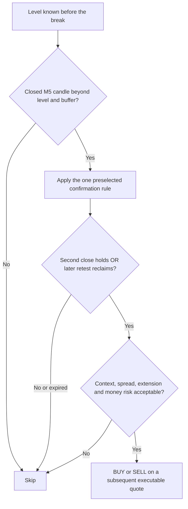

# GOLDNIX: analysing false breakouts before new tests

Research date: **2026-11-12**. Scope is analysis only. No new strategy tests,
backtests, parameter searches, orders, or changes to the existing runner are
part of this note. The 68-variant historical research record and Step 6 status
remain unchanged.

## First distinguish a failed trade from a false breakout

The current demo enters scheduled BUYs without identifying a breakout level.
Its stop-outs therefore cannot be counted as false breakouts. The earlier
proposed M5 trigger—close above the preceding bar's high, or below its low—also
needs qualification: it detects a short-term crossing but does not itself
establish previously respected support or resistance.

Separate three possible causes before choosing a remedy: **a breakout signal
that was invalid or failed**, **ordinary range movement reaching a narrow
fixed stop**, and **spread or quote-side execution effects**. They can overlap,
but a confirmation filter addresses a different problem from stop placement
or executable-price accounting. The current evidence does not identify which
cause explains each loss.

Before evaluating a breakout, define a level from information already
available: for example, a fixed lookback range of completed M15 bars or a
confirmed swing. Freeze its value, source bars, availability time and expiry
before the attempted break. Do not redraw the level using the later reversal.

## What primary research explains, and what it does not

Osler's study of support/resistance supplied by six FX firms found predictive
value for intraday trend interruptions, with substantial differences across
firms and currencies. This concerns published levels and 1990s exchange rates,
not arbitrary preceding-candle highs or modern M5 gold CFDs.
[NY Fed study, printed pp. 53–68](https://www.newyorkfed.org/medialibrary/media/research/epr/2000/EPRvol6No2.pdf).

A separate examination of bank currency orders found clustering around round
numbers and different stop-loss/take-profit patterns. Subsequent research found
evidence of stop-loss orders amplifying currency movements in cascades. These
mechanisms can produce continuation as well as reversals; they do not imply
that every break should be faded.
[Osler SR125](https://www.newyorkfed.org/research/staff_reports/sr125.html),
[Osler SR150](https://www.newyorkfed.org/research/staff_reports/sr150.html).

Neither finding establishes manipulation in our broker feed. A candle wick,
stop-out, or later recovery is insufficient evidence of intentional “stop
hunting.” News can also cause genuine repricing: Andersen et al. found
announcement surprises associated with jumps in exchange rates. This is FX
evidence, not an attribution of any current gold move to a particular release.
[Original publisher abstract](https://www.aeaweb.org/articles?id=10.1257/000282803321455151).

## Define the outcome before counting it

For an upward attempt, use resistance `L`, a frozen buffer `b`, a predefined
follow-through distance `F`, and horizon `H` completed M5 bars. Choose their
construction before examining outcomes; mirror the rules for downward attempts.
Use one declared price series consistently. A qualifying attempt must cross
above `L+b`; smaller excursions above `L` remain a separate sub-buffer category
and do not enter the qualifying-attempt denominator.

| Label | Operational meaning |
|---|---|
| Wick rejection | High exceeds `L+b`, but that completed bar closes at or below `L`; it never confirmed a closing break. |
| Unconfirmed excursion | High exceeds `L+b`, but the close is above `L` and at or below `L+b`; no confirmed signal. |
| Failed follow-through | Following the first close `C0 > L+b`, a later close reaches `L-b` or lower within `H`, before a close reaches `C0+F`. |
| Follow-through | A later close reaches `C0+F` first, within `H`; this is a price label, not proof of a profitable trade. |
| Unresolved / ambiguous | Neither event occurs before expiry, data are missing, or intrabar event ordering required by a different label cannot be recovered from OHLC. |

Deduplicate repeated attempts at the same frozen level under a declared reset
rule. Future bars may determine these **analysis labels only**. They must never
enter the contemporaneous entry decision. If evaluating stop/target hits within
a bar, high/low alone cannot establish which happened first; retain ambiguity
or use suitable tick evidence.

## Candidate defences and their costs

These are hypotheses for a later protocol, not implemented improvements or
proven sources of net profit.

| Candidate | Proposed purpose | Tradeoff / limitation |
|---|---|---|
| Close beyond a meaningful level and buffer | Reject a touch or small overshoot. A possible buffer form is `max(k_s × spread, k_v × prior ATR)`, frozen from information available before the attempt. | Later/worse entries and missed fast winners; coefficients require a declared specification, not tuning to this session. ATR measures movement, not future direction. |
| **Alternative A: second-close hold** | After a closing break, require the next completed M5 close to remain beyond the frozen buffered level. | Pays another bar of delay; two closes can still fail. Cancel if the required hold fails. |
| **Alternative B: break–retest–reclaim** | After the break, wait for a later bar to revisit a predefined level zone and close back beyond the buffer in the intended direction. | Genuine breakouts may never retest; wide retest zones can admit failures. Specify whether one bar may both retest and reclaim. |
| Expiry and maximum extension | Cancel stale setups and skip a fill too far from the level rather than chasing. | Intentionally misses strong moves; measure missed winners as well as rejected failures. |
| Closed H1 context, with a neutral state | Permit aligned setups; SKIP when direction is mixed or data are insufficient. | Trend filters lag and may reject early reversals; H1 agreement is not independent confirmation. |
| Spread, volatility and scheduled-news checks | Skip conditions outside a declared operating envelope. | Filters can remove the largest favorable moves too; historical news timestamps and actual spreads are required to assess them fairly. |

Evaluate A **or** B as distinct candidates; stacking both with many indicators
creates an opaque selection rule. Assign each setup one frozen expiry `E`;
after it expires, require a new setup instead of extending its deadline. Keep
a failed setup flat until a new valid
setup and cooldown are satisfied. Do not immediately reverse direction or
increase size to recover a loss. Earlier H1 rejection variants S17–S24 already
had negative mean returns in this project; automatic contrarian flipping has
no established local advantage.
[Prior results](../goldnix_round2/README.md),
[registered definitions](../goldnix_round2/protocol.json).

A proposed structure/volatility stop must fit the **same predeclared money-risk
budget** at an allowed size. If a wider stop at the minimum 0.01 lot exceeds
that budget, SKIP. Wider stops at unchanged size increase nominal risk; they do
not remove failure. Gaps and slippage can still exceed the planned loss.

A lower false-breakout percentage alone is insufficient: almost never trading
can make that number look good. A later comparison must also report eligible
setup coverage, forgone follow-throughs, confirmation delay and entry-price
deterioration, and net expectancy after spread/slippage at the same money-risk
budget. Freeze the common decision clock and cooldown before attributing an
incremental benefit to a filter. No success rate or optimal threshold is
established here, and this three-hour session must not select the rules.

## Avoid apparent signals created by data handling

`CopyRates` position zero is the current, incomplete bar. Decisions based on
its temporary close/high can disappear before the bar finishes.
[MetaQuotes documentation](https://www.mql5.com/en/docs/series/copyrates).

A standard fractal requires two bars on each side of its centre. **Derived
implementation requirement:** wait for both following bars to complete. A
marker drawn back on the pivot is not evidence that the pivot was knowable at
that earlier time. Record confirmation time; do not let later “clean” chart
annotations leak into historical decisions.
[MetaQuotes fractal definition](https://www.metatrader5.com/en/terminal/help/indicators/bw_indicators/fractals).

For ordinary OTC execution, long stops are checked on Bid and short stops on
Ask. Charts can show Bid or Last; an Ask-side stop can therefore trigger while
a Bid-only candle appears not to touch it. Spread variation can affect both
apparent breaches and actual execution. Confirm this symbol's quote/trigger
conventions before attributing a stop to market structure.
[Order mechanics](https://www.metatrader5.com/en/terminal/help/trading/general_concept),
[chart prices](https://www.metatrader5.com/en/terminal/help/charts_advanced/charts_settings).

Tick volume counts quote/price activity; a burst can accompany disagreement,
repricing or a reversal. It does not by itself identify buyer dominance or
validate a breakout.
[MetaQuotes volume definition](https://www.metatrader5.com/en/terminal/help/indicators/volume_indicators).

## Local data review

The current session's **pre-run** export was captured at 11:44:47 UTC on
2026-11-12. It contains 150 M5 bars. Excluding the newest bar as potentially
incomplete leaves 149 completed bars. For each bar, calculate
`TR = max(high-low, abs(high-previous_close), abs(low-previous_close))`.
The last 14 completed true ranges sum to **33.27 gold-price units**; their
simple mean is **2.3764**. This explicitly uses a simple mean, not an assumed
match to any platform indicator's smoothing or initialization.

The test's base bid-to-stop distance of **1.00** is about **0.42 times** that
pre-run mean true range. The BUY's actual entry-to-stop distance also includes
the spread and any fill difference. These are gold-price distances, not dollar
amounts lost from the account.

This raises a stop-width/volatility question independently of fakeout filtering.
It does not identify an optimal stop, establish the volatility of every later
trade, or prove that each stop was too narrow. The earlier review found eight
stop-loss exits in the first 13 scheduled BUYs, but none had a recorded breakout
level. Calling them “eight fakeouts” would be unsupported.

The [archived calculation](../goldnix_venue/out/fakeout_context_20261112/CONTEXT.json)
includes every input true range, the exact decimal arithmetic and exclusions.
[Raw pre-run bars](../goldnix_venue/out/fakeout_context_20261112/preflight_bars.csv)
and their [hash manifest](../goldnix_venue/out/fakeout_context_20261112/MANIFEST.json)
make this descriptive calculation reproducible. It is not a strategy backtest.

## Decision sequence to specify before a new test

“OR” represents two alternative research candidates, not permission to choose
whichever looks better after observing a setup. A completed confirmation is
still not a guarantee of continuation. A rejected breakout also does not
automatically authorize a trade in the opposite direction.

Before any new strategy test, the written protocol needs:

- An exact causal level definition and one frozen buffer formula, including
  timeframe, lookback, price series and which pre-break volatility/spread
  observations are used.
- One confirmation rule per candidate, its retest tolerance if applicable,
  maximum extension, one setup expiry, reset/cooldown, and the event-label
  horizon and follow-through distance. No thresholds are selected from today's
  losses in this note.
- Verified H1/M15/M5 timing, indicator warm-up, bid/ask tick coverage, and news
  timestamps if a news exclusion is proposed. Missing data must be explicit.
- The same declared money-risk and execution assumptions for comparisons;
  entry-filter and exit/stop changes must have separately attributable results.
- A later untouched evaluation period and a record of all attempted variants,
  reporting missed winners and opportunity coverage as well as failed breaks.

The immediate recommendation is to complete that specification and data audit.
No additional strategy experiment, parameter sweep, new order session, or
change to the existing runner was started for this analysis. The previously
authorized timed demo session continues under its original rules.
