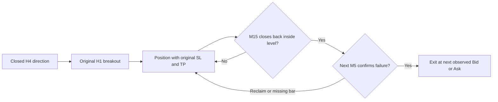

# H4 → H1 → M15 → M5 context and fakeout evaluation

**Implemented and tested on all four 2005–2025 eras. Neither new candidate
qualifies for deployment or Step 7.** H4 context slightly improves average R
and lowers simulated annual drawdown, but leaves fewer than the required
1,000 trades. The added early-exit rule has a negative return lower bound.
The original H01 reference is preserved and reproduces all 1,025 trades.

## Rules registered before evaluation

This batch adds exactly two research variants to the disclosed history, now
at least 88 variants plus earlier uncounted choices. It changes no original
gate threshold and performs no parameter search after seeing these results.

`H02_H4` takes the original H01 H1 channel20 signals only when the latest
complete H4 midpoint close and EMA50 slope agree with the entry direction.
EMA slope compares three completed H4 bars. H4 requires 100 complete candles;
incomplete or stale candles cannot supply a direction.

`H03_H4_FAKEOUT` adds the following management rule to H02:

1. Freeze the broken H1 channel level and a buffer equal to the larger of
   signal spread or 0.1 H1 ATR at entry.
2. A complete M15 close back inside the channel by more than that buffer
   creates a warning. This is an observation, not proof of a future stop-out.
3. The immediately following complete M5 candle must also close beyond that
   adverse threshold. A reclaim or missing confirmation bar cancels the warning.
4. After confirmation, close at the next observed executable M5 open:
   Bid for BUY, Ask for SELL. A confirmed intent persists across missing quotes;
   its eventual fill can be worse than the confirmation close.

Original server-style SL/TP remain in effect. A stop/target already reached
before a discretionary exit takes precedence. There is no wider stop, new lot
size, extra entry layer, invented M1 path or promise to predict reversals.
BUY and SELL mirror each other. H4/M15 inputs become available only after close.



Attaching an EA to an M1 chart does not require M1 signals. This experiment
retains H1 decisions and M5 execution detail. It does not turn H01 into the
current M1 P01 strategy. A volume gate was not invented because the historical
feed's volume units and target-venue comparability are unqualified.

## Full-period results

All cash figures below are **USD totals over approximately 20.6 years** at
0.01 oz exposure, after modeled spread and before unverified extra costs.
They are not monthly returns or forecasts. Annual p99 drawdown is from 100,000
IID simulated paths; the lower bound uses 10,000 month-block resamples.

| Version | Trades | Mean R | Mean lower bound | Net USD | Annual simulated p99 DD, USD |
| --- | ---: | ---: | ---: | ---: | ---: |
| Original H01 | 1,025 | +0.12013 | +0.03532 | +4.18510 | 1.01005 |
| H01 with H4 readiness only | 993 | +0.11339 | +0.02485 | +3.74047 | 0.98533 |
| H02: H4 directional filter | 647 | +0.12247 | +0.01448 | +2.61511 | 0.77430 |
| H03: H4 + M15/M5 failure exit | 732 | +0.04340 | −0.03976 | +0.81436 | 0.68704 |

H01's trade records match the original frozen record in every original column.
The bootstrap/Monte Carlo seeds were declared for this comparison, so their
estimates differ slightly from the original H01 report; the strategy has not
changed. The common-readiness comparator separates data availability from the
directional filter.

H02 passes preliminary G1/G4/G6/G7/G8 and fails G5. H03 fails G1 and G5.
Both therefore stop before the conditional matched-baseline stage: G2/G3
remain unevaluated. Native parity for the new H4 context is also unverified.
Neither is a nine-gate PASS. Earlier H01 results are not copied into their
missing gates. Lower simulated drawdown partly reflects fewer trades; H02's
historical realized maximum drawdown is actually higher than H01's
($1.28888 versus $1.18516).

Per-era net USD:

| Era | H01 | H02 H4 | H03 failure exit |
| --- | ---: | ---: | ---: |
| A: June 2005–August 2011 | +1.82189 | +1.04465 | −0.01066 |
| B: September 2011–2015 | +1.42301 | +0.70449 | +0.43676 |
| C: 2016–2020 | +0.52637 | +0.47959 | +0.22430 |
| D: 2021–2025 | +0.41382 | +0.38638 | +0.16396 |

Original G4 counts positive **mean R**, not net cash, so H03 still passes G4
despite its small negative cash result in era A. Varying ATR means these two
statistics need not have the same sign.

## What the fakeout rule got wrong

The rule caused 400 early exits. A posthoc comparison with each identical
entry's fixed-SL/TP path found:

- 314 improved that entry's eventual P/L.
- 85 worsened it; one was unchanged.
- 56 of the fixed paths would later have reached TP.
- The sum of same-entry P/L differences was **−$1.44960**.

Avoiding many small losses did not compensate for the larger opportunities
cut short. A close back inside a level can be an ordinary pullback before
continuation. This evidence explains why a higher/lower-timeframe reference
must be measured rather than assumed to prevent losses.

Those fixed paths are isolated counterfactuals. Some would overlap other
managed entries, so their sum is not a valid alternative account schedule.
The separate full account simulations above enforce the one-position and daily
halt rules. No new exit threshold was selected from these diagnostic labels.

## Verification and current deployment

39 relevant tests pass, including 10 new behavior tests. They check closed-bar
availability, stale/missing higher candles, future-prefix invariance, mirrored
BUY/SELL behavior, reclaim cancellation, stop-before-confirmation, later intrabar
stops, gap-stop priority and delayed quote fills. Ruff passes. The native context
has not been compiled/deployed, so these checks are Python research validation.
An existing NumPy/pandas timedelta deprecation warning remains in the unchanged
shared aggregation helper.

The original H01 remains the historical reference. The active demo remains
P01 v1.20 with profit protection; no new filter or early-close rule was installed
on the account. User authorization for Step 7 is recorded, but a matching
untouched holdout is still missing. Existing 2026 history was not reopened.
Nothing in this batch constitutes a Step 7 pass or starts a future evaluation.

- [Registered protocol](protocol.json).
- [Full compact results](evidence/RESULT.json).
- [Fakeout diagnostic](evidence/FAKEOUT_DIAGNOSTIC.json).
- [Hashes and source paths](evidence/provenance.json).
- [Local full run](out/H02_20261113T082531Z/RESULT.json), including all candidate
  trade lists, eligible outcome pools, source snapshots and a SHA-256 manifest.

```sh
PYTHONPATH=goldnix:. .venv/bin/pytest -q goldnix_h02/tests goldnix_mtf2/tests goldnix_step6/tests
PYTHONPATH=goldnix:. .venv/bin/python -m goldnix_h02.evaluate
```

Reproduction requires the preserved local H01 artifacts, H1 source CSV and
validated M5 cache. Raw history and generated run files are excluded from Git.
